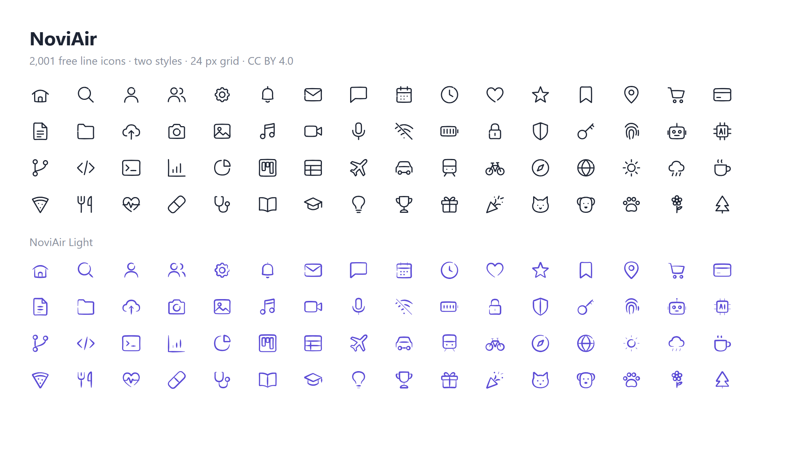

# NoviAir

2,001 free line icons in two styles by [Novissium](https://novissium.com).

Light, slightly curved lines with round ends – like drawn by hand, but tidy. Made on a 24 px grid for interfaces, websites and apps.



## Two styles

| Style | Folder | Icons | Drawing |
|---|---|---|---|
| **NoviAir** | `svg/noviair/` | 2,001 | even stroke, 1.25 px – stroke width can be changed |
| **NoviAir Light** | `svg/noviair-light/` | 2,001 | pen stroke, thin at the ends – fixed shape |

Both styles contain the same icons with the same file names.

```
svg/noviair/        stroke icons
svg/noviair-light/  pen-stroke icons
```

## Usage

- All icons use a `0 0 24 24` viewBox and `currentColor`, so they take the text colour of their surroundings.
- **NoviAir:** `fill="none"`, `stroke="currentColor"` and `stroke-width="1.25"` sit on the `<svg>` element. Change the stroke width with one attribute or one line of CSS, for example `svg { stroke-width: 2; }`. Recommended range: 0.75 – 2.
- **NoviAir Light:** filled shapes (`fill="currentColor"`), the stroke width is part of the drawing.
- Many icons come with small variants in the lower right corner, for example `file-plus`, `user-check`, `calendar-clock`, `cloud-arrow-up`, and with `-off` variants such as `wifi-off`.

## Topics

Interface, arrows, text editing, files, office, finance & shop, communication, media, devices, development & AI, security, health, education, science, travel & mobility, weather & nature, house & smart home, food & kitchen, sport & leisure, animals, events, charts, shapes, numbers and more.

## More from Novissium

Colourful 3D glass icons, also animated: NoviGlow – see [novissium.com](https://novissium.com).

## License

The icons in this repository are licensed under [Creative Commons Attribution 4.0 International (CC BY 4.0)](https://creativecommons.org/licenses/by/4.0/).

You may use, share and adapt them, also commercially, as long as you give credit:

> Icons: NoviAir by Novissium – https://novissium.com
